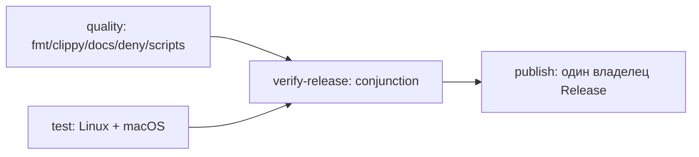

# CI/CD Rivect

## Решение

2026-11-16. Исходный кандидат: `c02f551b64ca061b78eac02184bc8d4d731e9c8c`.
Область: GitHub Actions, скрипты evidence и test-only потребление готового bundle.
Продуктовые требования и denominator release conjunction не меняются.
Исследование 22 первоисточников хранится локально в `research/ci-cd-design.md`,
в Git не включается. Принятое решение: [ADR-0005](adr/0005-ci-artifact-promotion.md).

Критерий: каждый Cargo target исполняется одним владельцем на платформу в одном
workflow run; package/publisher не повторяют suite. Все release-проверки относятся
к неизменным байтам готового native bundle. Ошибка producer, отсутствующий receipt
или несовпадающий hash не превращаются в готовый релиз.



`quality` и `test` выполняются для PR, main, tag и ручного запуска. Последние два
узла — только для `v*` tag. PR не получает write token или production secrets.
Tag должен совпадать с Cargo version. Поддерживаемые native targets:
`x86_64-unknown-linux-gnu` на Ubuntu 24.04 и `aarch64-apple-darwin` на macOS 15.
Runner labels закреплены; конкретный образ VM продолжает обновляться GitHub.

## Установка опубликованного релиза

```sh
curl -fsSL https://github.com/ViktorsBaikers/Rivect/releases/latest/download/install.sh | sh
```

Поддерживаются macOS Apple Silicon (`aarch64-apple-darwin`) и Linux x86_64
с glibc (`x86_64-unknown-linux-gnu`, build/runtime baseline Ubuntu 24.04).
Intel macOS, Linux ARM64 и musl этой поставкой не поддерживаются.
Пользователю не нужны Cargo, `gh`, `jq` или Python. Архив содержит ровно
`rivect`, `rivect-sandbox-helper`, `rivect.manifest.json`; helper устанавливается
рядом с CLI. Архивы называются `rivect-v0.1.2-TARGET.tar.gz`, checksums —
`TARGET.sha256`. Корневой пакет — 0.1.2, независимый helper остаётся 0.1.0;
существующие теги `v0.1.0` и `v0.1.1` не переносятся.
До переключения активного bundle установщик проверяет запуск CLI через
`--version`; несовместимый бинарник не заменяет работающую установку.
Установка без `sudo`: полные bundles хранятся в
`~/.local/share/rivect/releases/ARCHIVE_SHA256/`, атомарный symlink
`~/.local/share/rivect/bin` выбирает активный bundle. Установщик однократно
добавляет этот bin в PATH через профиль shell: `${ZDOTDIR:-$HOME}/.zshrc`
для zsh, `~/.bashrc` и login profile для bash, `~/.profile` для sh/неизвестного
shell, `~/.config/fish/config.fish` для fish. Pipe не меняет PATH родительского
shell: после установки нужно открыть новый терминал или перечитать профиль.


Ubuntu 24.04 сохраняется как build/runtime baseline: переход на новый runner ради
`setpriv` поднял бы glibc baseline архивов. `ci-linux-prerequisites.sh` собирает
только `setpriv` util-linux 2.41.5 из upstream tarball с закреплённым SHA-256 и
устанавливает его в `/usr/bin/setpriv` disposable VM; системные библиотеки и
production bundle не меняются. Источник и checksum проверены 2026-11-16:
[upstream checksums](https://mirrors.edge.kernel.org/pub/linux/utils/util-linux/v2.41/sha256sums.asc).
Лицензия utility — GPL-2.0-or-later; utility не включается в поставку Rivect.

## Владельцы проверок

| Проверка | Владелец | Исключение повтора |
| --- | --- | --- |
| fmt, clippy, rustdoc, cargo-deny, workflow/shell contracts, offline installer tests | quality | Не выполняются в publisher |
| lib/bin/examples и все integration targets workspace | `scripts/ci-test.py` | Перечень из `cargo metadata`; один вызов на target |
| process-heavy helper | тот же runner | Первый пакет, один test thread |
| обычные targets | тот же runner | Два test threads; не автоматические retries |
| doctests | отдельный step test | Явный target selection выше их не включает |
| provider/acceptance/search evidence | `offline-evidence.sh --logs-dir` | Проверяет один сохранённый execution вместо повторного Cargo |
| installed ordinary и UI matrix | их integration targets | Receipts пишутся при первом прогоне, не запускаются повторно gate |
| platform-exclusive legs | `xhost-serve.sh` | Читает PASS + hash-bound execution + отсутствие NOT_RUN; тесты не запускает |
| final conjunction | `release-gate.sh --receipts-only` | Остальные negative tests этого target уже прошли; exact conjunction отложен |
| release mutation | publish | Один job для обеих платформ, без checkout/Cargo/кандидатных executables |

Повтор на другой ОС — проверка другого native carrier, не дубль. Main/PR/tag —
независимые события; они могут проверять один source SHA повторно. Между событиями
не введён privileged `workflow_run` или доверие произвольному старому cache.
Дедупликация относится к одному workflow run, а не к произвольной истории сборок.

## Кандидат и evidence

1. `package-release.sh` создаёт bundle вне checkout, отказывает при существующем
   destination. Smoke: настоящий `rivect --version` и `--help`.
2. Test-only `RIVECT_TEST_BUNDLE` заставляет baseline fixture проверить supplied
   manifest/binary hashes и build identity, затем скопировать точные байты в свой
   tempfile. Ошибочный override не вызывает альтернативную сборку.
   Без override сохранён обычный локальный packaging fixture.
3. Runner сохраняет полный лог, exit code, фактическую команду, manifest SHA-256 и
   output SHA-256 на target. `--show-output` сохраняет per-test PASS строки и
   успешные markers без nocapture-interleaving. Failed targets сохраняют логи,
   но не создают family receipts. Новый target автоматически попадает в inventory.
4. Producer проверяет digest/status/candidate, обязательные oracle PASS и markers.
   Несколько manifests потребляют один execution. Логи и receipts не входят в
   compilation cache.
5. Native bundle переносится как tar.gz: ZIP artifact не должен потерять executable
   mode. Receipts связывают source SHA, run ID, platform и manifest digest native
   кандидата. Cross-host bind требует обе платформы и точный allowlist legs,
   проверяет inventory и binary hashes обоих архивов **до распаковки executable**.
6. Verify восстанавливает собственные receipts, применяет разрешённый cross-host
   fold, запускает только exact conjunction. Release archive копируется из test
   artifact побайтно: нет повторной production-сборки или перепаковки.
   Корневой `install.sh` копируется в отдельный `install-TARGET.sh` для каждой
   платформы; SHA-256 этих байтов включается в её verdict как `installer_sha256`.
7. Publisher требует обе платформы, валидные verdicts, archive checksums и tag SHA,
   совпадающий с проверенным source. Он проверяет installer digest каждого verdict
   и побайтное равенство двух копий, затем загружает ровно один `install.sh` и
   `install.sh.sha256`, не исполняя скачанный код с write token.
   Тег проверяется до создания draft и повторно после загрузки assets,
   непосредственно перед публикацией. Только общий ready публикует draft.
   Upload failure не выставляет частичный stable.

Exit 0 — ready и ноль retained legs; exit 5 — честно вычисленный non-ready,
остаётся общим draft/prerelease с verdict JSON. Допустимы только conjunction exits
0 и 101 (libtest assertion failure). Остальные exits, включая 137/143, отсутствие
или невалидный verdict и failed conjunction при ready=true — failure, не draft-успех.
Существующий Release не перезаписывается: повтор после частичной публикации требует
проверки уже существующих assets, а не `--clobber` или движения тега.

## Безопасность и воспроизводимость

- Actions закреплены полным owning commit SHA; first-party runtime Node24.
- Checkout не сохраняет credentials. Только publisher получает `contents: write`;
  у него нет checkout, Cargo, cache или запуска скачанного кода.
- Download ограничен текущим workflow run; digest mismatch — error. Проверяется
  полнота ожидаемых файлов, а не только успех wildcard download.
- Cache — только ускоритель зависимостей. Save разрешён main, PR — restore-only.
- Rust/components берутся из `rust-toolchain.toml`; lockfile не обновляется CI.
- Linux namespace prerequisite задан каждому job, который реально исполняет
  sandbox. Раньше его отсутствие ломало package с errno 13.
- Secret Service — локальный disposable D-Bus session и тестовый namespace;
  production OAuth/LLM/API не вызываются. macOS использует тестовый keychain namespace.
- Job timeouts и `fail-fast: false` ограничивают ожидание, сохраняя результат каждой
  платформы. Устаревший PR отменяется; release не прерывается новым PR.
- `actionlint` закреплён на v1.7.12; shellcheck и Python stdlib проверяют скрипты.
  SHA pins не делают транзитивные downloads/OS images полностью immutable.

## Известные границы

Три существующих repository-policy tests требуют не поставляемые в source checkout
agent/ADR/research inputs. Runner пропускает их **только при отсутствии prerequisites**
и записывает точные имена `NOT_RUN` в `target/ci-logs/not-run.json`.
Пять Linux `/proc`-oracles `index_worker` остаются в Linux leg, не исполняются на macOS.
Exact conjunction отмечен как отложенный в test job и исполняется tag verify job.
Это не утверждение, что весь локальный §14 gate прошёл на clean GitHub checkout.
Локальный §14-набор остаётся обязательным и не ослаблен.

Автоматическая настройка branch protection, required-check names, immutable tags,
protected release environments, signing и credentials не выполняется этим diff.
Проверка тега и undraft — отдельные API calls, не атомарная операция; запрет движения
релизных тегов должен обеспечиваться repository ruleset.
При включённых required checks оператор должен заменить старые `gate-linux` и
`test-macos` на `quality`, `test-linux`, `test-macos`; имена зависят от реальных
repository rulesets. Не двигать существующий `v0.1.0`: изменённый workflow требует
нового явно разрешённого push/tag. `--preapprove` не меняет правила хоста для Git.

## Проверка изменения

- `python3 scripts/ci-contract-tests.py`: реальные subprocess/fs проверки dedup,
  failed/stale/tampered evidence, cross-host binding, gate exit semantics и 12
  исполняемых сценариев publisher: исходные девять плюс подмена, отсутствие
  и несовпадение installer; проверяется единственный uploaded installer asset.
- `python3 scripts/install-contract-tests.py`: offline installer contracts.
- `actionlint .github/workflows/ci.yml`; `sh -n install.sh`;
  `shellcheck install.sh scripts/*.sh`.
- Полный локальный §14-набор и authentic supplied-bundle regressions.
- Remote CI/publication не считаются проверенными по локальным mocks. Конкретный
  результат запуска и оставшиеся ограничения записываются в отчёте исполнения.

### Локальный результат 2026-11-16

- PASS: 11 Python contract tests, `actionlint`, `shellcheck`; 17 native release tests
  с supplied candidate; настоящий CLI `--version`/`--help`.
- Финальный локальный §14-набор: все семь команд завершились exit 0;
  `cargo test --workspace` — 3776 passed, 68 suites, 85 ignored;
  doctests — 43 passed. Логи: `/tmp/rivect-ci-final.YoVkvd/gate-{0..6}.log`.
- Прежний MCP timeout (`duplicate_input_required_reuses_one_operation_p4`)
  сохранён в `/tmp/rivect-ci-proof.ZeVo5e/gate-3.log`. В финальном полном
  прогоне тест прошёл; причина прежнего сбоя не установлена, исправление
  MCP не заявляется.
- Cold Linux proof выявил необходимый debug-helper prebuild; runner исправлен,
  существующий contract test прошёл RED→GREEN. Два test-only measurement seams
  исправлены без изменения production timeout или порогов: native procfs retirement
  после join и измерение CloudCode send отдельно от SQLite/settlement.
- Native macOS runner прошёл. Финальный Linux runner: 64 команды, все exit 0;
  3774 passed, 89 ignored; затем doctests. Cold debug-helper prebuild проверен.
  Все семь corpus legs по 100 samples прошли неизменные frozen limits.
- Corpus исполнялся после fresh candidate build, как в workflow: release cache
  соответствует source. Owned RSS — 92401664 bytes при лимите 2147483648;
  прежний cold-rebuild sample не считается warm-baseline результатом.
- Consumer-only promotion проверен на обоих подлинных archives без producer reruns:
  Linux gate exit 0, retained legs 0; macOS exit 5, retained leg `ingress.exec`
  из-за local Homebrew Git/pcre2 вне sandbox. Sandbox не ослаблен.
- Proof carriers: Linux arm64 Docker и native macOS arm64, не hosted
  Ubuntu x86_64/macOS-15. Итоговые команды, manifests и логи: EVID-20-95.
- Независимое correctness review: подтверждённых дефектов нет. Два security findings
  закрыты кодом и regression proof: повторная tag check; abnormal-exit rejection.
- Push `9b2ce35` выполнен. Первый hosted run
  [43930457186](https://github.com/ViktorsBaikers/Rivect/actions/runs/43930457186)
  завершился FAIL: ShellCheck SC2015, Linux `setpriv` без Landlock options,
  macOS `index_worker` и `search_index`. Package artifacts не созданы; сохранены
  diagnostics обеих платформ. Tag/publication не запускались.
- Исправления среды после hosted FAIL: ShellCheck clauses переписаны как `if`;
  util-linux 2.41.5 собран на настоящем Ubuntu 24.04 container, Landlock
  in-scope write прошёл, outside write получил Permission denied. 11 Python
  contracts, actionlint и Ubuntu 24.04 ShellCheck прошли. Это не hosted GREEN.
- macOS memory cause пока не установлена: локальный bounded probe на Darwin 27
  не воспроизвёл поведение macOS 15; hosted stderr и peak footprint отсутствуют.
  Классификация ошибок и memory limits не ослаблялись.
- Watcher repair подавляет membership invalidation только для собственного runtime.
  Для name-only exclusions `target`, `node_modules`, `.git` membership flag сохранён:
  эти имена не доказывают исключение файла из настоящего enumeration policy.
  Regression проверяет automatic create/delete repair в `src` и unignored
  `node_modules`, полный snapshot oracle и stale предыдущего generation.
  Предшествующие RPC errors входят в narrowing failure diagnostics; исходная
  причина hosted narrowing FAIL ещё не доказана.
- Diagnostic follow-up: raw native peak accessor сохраняет ABI296/offset240;
  отдельное synthetic воспроизведение запускается только после исходного memory
  failure. Custody сохраняется до final sample, stderr bounded/sanitized,
  сомнительные наблюдения остаются inconclusive. Контрольный настоящий child
  проверяет exit23, zombie sample, reap и stderr cap; исходные assertions не менялись.
- Полный локальный §14 после коррекций PASS: 3778 tests, 68 suites, 85 ignored;
  43 doctests; fmt/clippy/rustdoc/deny/locked fetch прошли. Fresh bundle и
  настоящий CLI smoke прошли. Логи: `/tmp/rivect-diag-final.vr0Kf7/`,
  `/tmp/rivect-ci-diagnostic-final-clippy.log`. `index_worker`: 49 passed,
  2 ignored. PID marker fixture публикуется атомарно после полной записи.
- Независимые scoped spec/code reviews: actionable membership-loss finding
  исправлен с реальным create/delete proof; owning recheck — no-findings.
- Push `800fa3f` выполнен. Hosted run
  [43962787351](https://github.com/ViktorsBaikers/Rivect/actions/runs/43962787351):
  quality и Linux PASS; macOS FAIL в `auth_band7` и `index_worker`.
  `search_index` прошёл. Это не общий CI GREEN.
- Linux package создан: artifact `xhost-linux` (14276901595). Скачанный archive
  содержит только `rivect`, `rivect-sandbox-helper`, `rivect.manifest.json`;
  hashes бинарников, executable modes и привязка receipt к commit/run проверены.
  SHA-256 manifest:
  `5a733d9281e206e470ccc4d56596e436a6e493b79645243b79b37f6a3d03e8c4`.
  Linux ELF на macOS не запускался. macOS package пока не создан.
- Hosted synthetic memory probes завершились ENOMEM/SIGABRT при peak ниже
  512 MiB; пересечение physical limit не доказано. Parser может законно первым
  получить process resource limit. Следующая коррекция сохраняет оба budget
  guards: physical fixture использует уникальные paced blocks; parser принимает
  объявленные memory/resource-limit outcomes с прежним deadline.
  Промежуточный `index_worker`: 49 passed, 2 ignored; fmt/clippy PASS.
  Review выявил недостаточный oracle: обычный SIGABRT тоже классифицируется
  как resource limit. Принимаемому сигналу нужна атрибуция из исходного запуска;
  отдельное synthetic воспроизведение её не заменяет. Исходный stderr теперь
  захватывается bounded exec-wrapper без смены PID, stdin, arguments или memory
  limits. Resource signal принимается только с каноническим Tree-sitter
  allocation/reallocation refusal. Настоящий посторонний SIGABRT отвергается;
  восемь positive calibrations проверяют classifier, не изображая OS observations.
  Финальный локальный `index_worker`: 50 passed, 2 ignored; fmt/clippy PASS.
  Логи: `/tmp/rivect-macos-attribution-native.log`,
  `/tmp/rivect-macos-attribution-clippy.log`. Scoped recheck: no-findings.
- Hosted polling guard наблюдал один poll при общей 400 ms квоте. Начальная
  HTTP работа тоже расходует квоту; фиксированный минимум polls не является
  переносимым oracle. Детерминированная замена прошла 8 unit и 28 integration
  tests: shared budget включает 300 s setup из 400 s; интервалы 20/40 s дают
  ровно 4/2 polls, истечение в 400 s и отсутствие публикации. Прежний отдельный
  publication-admission guard сохранён внутри owner test. Новый hosted proof NOT_RUN.
  Tag/Release не создавались; CI artifacts хранятся семь дней.
- Финальный локальный §14 (2026-11-17 UTC) PASS: workspace tests, отдельные
  doctests, fmt, clippy со всеми targets/features, rustdoc `-Dwarnings`,
  dependency policy и locked fetch. Inputs и полные логи:
  `/tmp/rivect-macos-final.dT1oyW/`; fmt/clippy и targeted memory log указаны выше.
  Настоящий CLI `--version`/`--help` прошёл с очищенным окружением и отдельным HOME.
  Это proof локального кандидата поверх `800fa3f`, не hosted GREEN нового commit.
- Push `be0d5e1` выполнен. Hosted run
  [43998350590](https://github.com/ViktorsBaikers/Rivect/actions/runs/43998350590)
  завершился FAIL: quality PASS; Linux остановился до сборки на `curl` exit 35
  (`Recv failure: Connection reset by peer`); macOS — только physical-memory
  fixture в `worker_failure_classification_is_typed_per_seam`.
  Auth и исправленный parser oracle прошли; исходный parser stderr:
  `tree-sitter failed to allocate 81920 bytes`, `ResourceLimit { signal: 6 }`.
  Это настоящий исходный запуск, не synthetic reproduction.
- Тот же pinned util-linux archive скачан локально с ожидаемым SHA-256.
  Это подтверждает содержимое источника, не исправность сети GitHub runner.
  Network bootstrap code не менялся. Physical fixture требует отдельного
  parent-observer proof без гонки с child address-space guard; коррекция в работе.
- Physical fixture теперь изолирует настоящий parent RSS observer: test-only
  pass-through launcher явно не применяет и не аттестует native AS/DATA caps.
  Конечный writable load — budget + 64 MiB; ожидается строго
  `MemoryExceeded`/`BudgetExhausted`. Budget − 128 MiB control доказывает полную
  readiness и проходит настоящий footprint check перед контролируемой отменой.
  Нет unbounded allocation, pacing, увеличения budget или deadline.
  Genuine-helper parser proof и все остальные classifier seams сохранены.
- Локальный target: 50 passed, 2 ignored; over — `MemoryExceeded`, under —
  `Cancelled`, readiness true. Fmt/clippy PASS; independent frozen-source
  recheck — no-findings. Логи `/tmp/rivect-parent-footprint-{native,clippy}.log`.
  Полный повторный workspace gate выполняется; hosted proof этой коррекции NOT_RUN.
- Повторный полный §14 поверх `be0d5e1` PASS (2026-11-17 UTC):
  workspace tests, отдельные doctests, fmt, all-target/all-feature clippy,
  rustdoc `-Dwarnings`, dependency policy, locked fetch. Source inputs и логи:
  `/tmp/rivect-parent-final.mkRGF0/`. Код production не изменялся.
- Push `e065a6f` выполнен. Run
  [44039494430](https://github.com/ViktorsBaikers/Rivect/actions/runs/44039494430):
  quality и macOS PASS; macOS package `xhost-macos` создан (artifact 14309562457).
  Это первый hosted PASS изолированного physical-observer proof.
  Общий CI всё ещё FAIL: Linux дошёл до candidate build, затем runner отказал
  на существующем пустом `target/ci-logs` (`FileExistsError`), до запуска targets.
- Runner теперь допускает только пустую directory shell, но отвергает symlink
  или любые прежние evidence entries. Exclusive `invocation.log` резервирует
  единственного владельца до Cargo. Нет удаления старых данных или повторного
  исполнения targets. Реальный runner CLI regression прошёл RED→GREEN:
  13 Python contracts PASS, включая неизменность evidence при replay и
  отсутствие записи через symlink. Логи `/tmp/rivect-ci-empty-logs-{red,green}.log`.
- macOS artifact 14309562457 для `e065a6f` скачан и проверен: ZIP SHA-256
  `29261cddec0a001d301fa6e5d055f57c600eb1088354fde4dd510f42f0c170b5`;
  manifest SHA-256
  `e46e100f399f32bc2e3a871f1058f3731673b86da201e3a4b4717f15f131468f`.
  Receipt привязан к commit/run/platform и `auth.keychain`; archive содержит
  ровно три regular files, binary digests и executable permissions совпали.
  Это частичный package proof: Linux artifact этого run отсутствует,
  общий CI не GREEN. Binaries локально не запускались.
- Финальный набор содержит 15 contract tests: дополнительно проверены stale logs
  без owner marker и два конкурентных runner до первого Cargo target.
  Реальная CLI-проверка с ограниченным loopback-gate подтверждает единственного
  владельца; исходный runner при этом не менялся. PASS: 15 tests, 23.882 s,
  `/tmp/rivect-ci-freshness-final.log`. Rust inputs совпадают с §14 proof
  `/tmp/rivect-parent-final.mkRGF0/`; нового Rust-прогона для Python-only diff нет.
- `devrites-engine check dup --worktree`: exit 2, scan incomplete — просканирован
  161 файл; один eligible file недоступен или превышает лимит. Единственный
  показанный cluster — headers/imports и объявления SHA-256 helpers.
  Общий helper не добавлялся: test oracle остаётся независимым. Это не PASS
  проверки дубликатов; ограничение сохранено явно.
