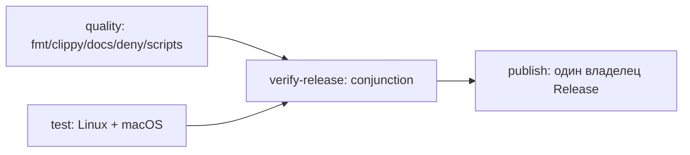

# CI/CD Rivect

## Решение

2026-11-16. Исходный кандидат: `c02f551b64ca061b78eac02184bc8d4d731e9c8c`.
Область: GitHub Actions, скрипты evidence и test-only потребление готового bundle.
Продуктовые требования и denominator release conjunction не меняются.
Основания и границы чтения: [исследование 22 первоисточников](../research/ci-cd-design.md).

Критерий: каждый Cargo target исполняется одним владельцем на платформу в одном
workflow run; package/publisher не повторяют suite. Все release-проверки относятся
к неизменным байтам готового native bundle. Ошибка producer, отсутствующий receipt
или несовпадающий hash не превращаются в готовый релиз.

`quality` и `test` выполняются для PR, main, tag и ручного запуска. Последние два
узла — только для `v*` tag. PR не получает write token или production secrets.
Tag должен совпадать с Cargo version. Поддерживаемые native targets:
`x86_64-unknown-linux-gnu` на Ubuntu 24.04 и `aarch64-apple-darwin` на macOS 15.
Runner labels закреплены; конкретный образ VM продолжает обновляться GitHub.

## Владельцы проверок

| Проверка | Владелец | Исключение повтора |
| --- | --- | --- |
| fmt, clippy, rustdoc, cargo-deny, workflow/shell contracts | quality | Не выполняются в publisher |
| lib/bin/examples и все integration targets workspace | `scripts/ci-test.py` | Перечень из `cargo metadata`; один вызов на target |
| process-heavy helper | тот же runner | Первый пакет, один test thread |
| обычные targets | тот же runner | Два test threads; не автоматические retries |
| doctests | отдельный step test | Явный target selection выше их не включает |
| provider/acceptance/search evidence | `offline-evidence.sh --logs-dir` | Проверяет один сохранённый execution вместо повторного Cargo |
| installed ordinary и UI matrix | их integration targets | Receipts пишутся при первом прогоне, не запускаются повторно gate |
| platform-exclusive legs | `xhost-serve.sh` | Читает PASS + hash-bound execution + отсутствие NOT_RUN; тесты не запускает |
| final conjunction | `release-gate.sh --receipts-only` | Остальные negative tests этого target уже прошли; exact conjunction отложен |
| release mutation | publish | Один job для обеих платформ, без checkout/Cargo/кандидатных executables |

Повтор на другой ОС — проверка другого native carrier, не дубль. Main/PR/tag —
независимые события; они могут проверять один source SHA повторно. Между событиями
не введён privileged `workflow_run` или доверие произвольному старому cache.
Дедупликация относится к одному workflow run, а не к произвольной истории сборок.

## Кандидат и evidence

1. `package-release.sh` создаёт bundle вне checkout, отказывает при существующем
   destination. Smoke: настоящий `rivect --version` и `--help`.
2. Test-only `RIVECT_TEST_BUNDLE` заставляет baseline fixture проверить supplied
   manifest/binary hashes и build identity, затем скопировать точные байты в свой
   tempfile. Ошибочный override не вызывает альтернативную сборку.
   Без override сохранён обычный локальный packaging fixture.
3. Runner сохраняет полный лог, exit code, фактическую команду, manifest SHA-256 и
   output SHA-256 на target. `--show-output` сохраняет per-test PASS строки и
   успешные markers без nocapture-interleaving. Failed targets сохраняют логи,
   но не создают family receipts. Новый target автоматически попадает в inventory.
4. Producer проверяет digest/status/candidate, обязательные oracle PASS и markers.
   Несколько manifests потребляют один execution. Логи и receipts не входят в
   compilation cache.
5. Native bundle переносится как tar.gz: ZIP artifact не должен потерять executable
   mode. Receipts связывают source SHA, run ID, platform и manifest digest native
   кандидата. Cross-host bind требует обе платформы и точный allowlist legs,
   проверяет inventory и binary hashes обоих архивов **до распаковки executable**.
6. Verify восстанавливает собственные receipts, применяет разрешённый cross-host
   fold, запускает только exact conjunction. Release archive копируется из test
   artifact побайтно: нет повторной production-сборки или перепаковки.
7. Publisher требует обе платформы, валидные verdicts, archive checksums и tag SHA,
   совпадающий с проверенным source. Тег проверяется до создания draft и повторно
   после загрузки assets, непосредственно перед публикацией. Только общий ready
   публикует draft. Upload failure не выставляет частичный stable.

Exit 0 — ready и ноль retained legs; exit 5 — честно вычисленный non-ready,
остаётся общим draft/prerelease с verdict JSON. Допустимы только conjunction exits
0 и 101 (libtest assertion failure). Остальные exits, включая 137/143, отсутствие
или невалидный verdict и failed conjunction при ready=true — failure, не draft-успех.
Существующий Release не перезаписывается: повтор после частичной публикации требует
проверки уже существующих assets, а не `--clobber` или движения тега.

## Безопасность и воспроизводимость

- Actions закреплены полным owning commit SHA; first-party runtime Node24.
- Checkout не сохраняет credentials. Только publisher получает `contents: write`;
  у него нет checkout, Cargo, cache или запуска скачанного кода.
- Download ограничен текущим workflow run; digest mismatch — error. Проверяется
  полнота ожидаемых файлов, а не только успех wildcard download.
- Cache — только ускоритель зависимостей. Save разрешён main, PR — restore-only.
- Rust/components берутся из `rust-toolchain.toml`; lockfile не обновляется CI.
- Linux namespace prerequisite задан каждому job, который реально исполняет
  sandbox. Раньше его отсутствие ломало package с errno 13.
- Secret Service — локальный disposable D-Bus session и тестовый namespace;
  production OAuth/LLM/API не вызываются. macOS использует тестовый keychain namespace.
- Job timeouts и `fail-fast: false` ограничивают ожидание, сохраняя результат каждой
  платформы. Устаревший PR отменяется; release не прерывается новым PR.
- `actionlint` закреплён на v1.7.12; shellcheck и Python stdlib проверяют скрипты.
  SHA pins не делают транзитивные downloads/OS images полностью immutable.

## Известные границы

Три существующих repository-policy tests требуют не поставляемые в source checkout
agent/ADR/research inputs. Runner пропускает их **только при отсутствии prerequisites**
и записывает точные имена `NOT_RUN` в `target/ci-logs/not-run.json`.
Пять Linux `/proc`-oracles `index_worker` остаются в Linux leg, не исполняются на macOS.
Exact conjunction отмечен как отложенный в test job и исполняется tag verify job.
Это не утверждение, что весь локальный §14 gate прошёл на clean GitHub checkout.
Локальный §14-набор остаётся обязательным и не ослаблен.

Автоматическая настройка branch protection, required-check names, immutable tags,
protected release environments, signing и credentials не выполняется этим diff.
Проверка тега и undraft — отдельные API calls, не атомарная операция; запрет движения
релизных тегов должен обеспечиваться repository ruleset.
При включённых required checks оператор должен заменить старые `gate-linux` и
`test-macos` на `quality`, `test-linux`, `test-macos`; имена зависят от реальных
repository rulesets. Не двигать существующий `v0.1.0`: изменённый workflow требует
нового явно разрешённого push/tag. `--preapprove` не меняет правила хоста для Git.

## Проверка изменения

- `python3 scripts/ci-contract-tests.py`: реальные subprocess/fs проверки dedup,
  failed/stale/tampered evidence, cross-host binding, gate exit semantics и девять
  исполняемых сценариев publisher, включая движение тега во время загрузки.
- `actionlint .github/workflows/ci.yml`; `shellcheck scripts/*.sh`.
- Полный локальный §14-набор и authentic supplied-bundle regressions.
- Remote CI/publication не считаются проверенными по локальным mocks. Конкретный
  результат запуска и оставшиеся ограничения записываются в отчёте исполнения.

### Локальный результат 2026-11-16

- PASS: 11 Python contract tests, `actionlint`, `shellcheck`; 17 native release tests
  с supplied candidate; настоящий CLI `--version`/`--help`.
- Финальный локальный §14-набор: все семь команд завершились exit 0;
  `cargo test --workspace` — 3776 passed, 68 suites, 85 ignored;
  doctests — 43 passed. Логи: `/tmp/rivect-ci-final.YoVkvd/gate-{0..6}.log`.
- Прежний MCP timeout (`duplicate_input_required_reuses_one_operation_p4`)
  сохранён в `/tmp/rivect-ci-proof.ZeVo5e/gate-3.log`. В финальном полном
  прогоне тест прошёл; причина прежнего сбоя не установлена, исправление
  MCP не заявляется.
- Cold Linux proof выявил необходимый debug-helper prebuild; runner исправлен,
  существующий contract test прошёл RED→GREEN. Два test-only measurement seams
  исправлены без изменения production timeout или порогов: native procfs retirement
  после join и измерение CloudCode send отдельно от SQLite/settlement.
- Native macOS runner прошёл. Финальный Linux runner: 64 команды, все exit 0;
  3774 passed, 89 ignored; затем doctests. Cold debug-helper prebuild проверен.
  Все семь corpus legs по 100 samples прошли неизменные frozen limits.
- Corpus исполнялся после fresh candidate build, как в workflow: release cache
  соответствует source. Owned RSS — 92401664 bytes при лимите 2147483648;
  прежний cold-rebuild sample не считается warm-baseline результатом.
- Consumer-only promotion проверен на обоих подлинных archives без producer reruns:
  Linux gate exit 0, retained legs 0; macOS exit 5, retained leg `ingress.exec`
  из-за local Homebrew Git/pcre2 вне sandbox. Sandbox не ослаблен.
- Proof carriers: Linux arm64 Docker и native macOS arm64, не hosted
  Ubuntu x86_64/macOS-15. Итоговые команды, manifests и логи: EVID-20-95.
- Независимое correctness review: подтверждённых дефектов нет. Два security findings
  закрыты кодом и regression proof: повторная tag check; abnormal-exit rejection.
- Новый remote pipeline и GitHub publication — NOT_RUN. Push/tag не выполнялись.
